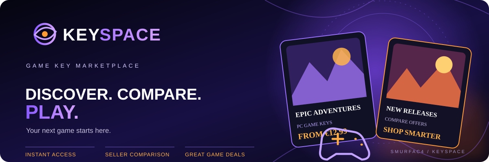
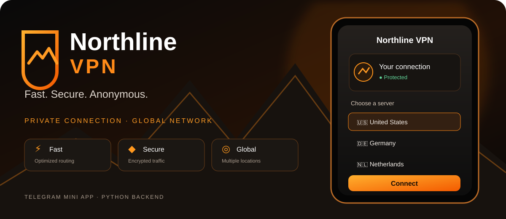

  <a href="#featured-projects">Featured projects</a> ·
  <a href="https://github.com/smurfac4?tab=repositories">All repositories</a>

## Hi, I'm Alex

I build web applications, backend services, automation tools and networking projects. I enjoy taking ideas from a working prototype to a polished, maintainable product.

## Featured projects

### 01 / CrossPost Studio — Content publishing & video automation

A publishing workspace for managing media, drafts, connected channels and scheduled delivery, with a dedicated Twitch clip workflow powered by FFmpeg.

**Python · FastAPI · SQLAlchemy · Celery · Redis · PostgreSQL · Docker · FFmpeg**

[Source code](https://github.com/smurfac4/crosspost-studio) · [Workspace screenshots](https://github.com/smurfac4/crosspost-studio#workspace-and-tools) · [Verification notes](https://github.com/smurfac4/crosspost-studio/blob/main/docs/VERIFICATION.md)

*In development. Live publishing depends on account access and provider permissions.*

### 02 / KEYSPACE — Game-key marketplace

A full-stack game-key marketplace with catalog filters, typo-tolerant search, seller comparison, accounts and simulated checkout.

**React · TypeScript · Go · PostgreSQL**

[Source code](https://github.com/smurfac4/game-key-marketplace) · [Live demo](https://keyspace-smurfac4.onrender.com) · [Real product screenshots](https://github.com/smurfac4/game-key-marketplace#screenshots)

*Promotional concept artwork; see the repository for real application screenshots. Demo checkout only — no real payments or redeemable keys.*

### 03 / Northline VPN — VPN infrastructure & Telegram Mini App

A Python Telegram bot and Mini App for managing VPN profiles and Telegram proxy connections. The backend includes server catalogs, availability checks and administration.

**Python · Telegram Mini Apps · Docker · OpenVPN · WireGuard · MTProto**

[Source code](https://github.com/smurfac4/northline-vpn-bot) · [Architecture and setup](https://github.com/smurfac4/northline-vpn-bot#readme)

*The banner is a visual concept, not a screenshot of a live service.*

### 04 / iRunner 2 — Programming education

A Django-based platform for programming courses, contests and automated judging.

**Python · Django · Docker · Automated judging**

[Explore the repository](https://github.com/smurfac4/irunner2)

## More projects

- [API Dashboard](https://github.com/smurfac4/api_dashboard) — Rails API and multi-organization administration dashboard.
- [To-Do App](https://github.com/smurfac4/to_do_app) — Rails task manager with priorities, deadlines and comments.

---

Always building, learning and improving.

