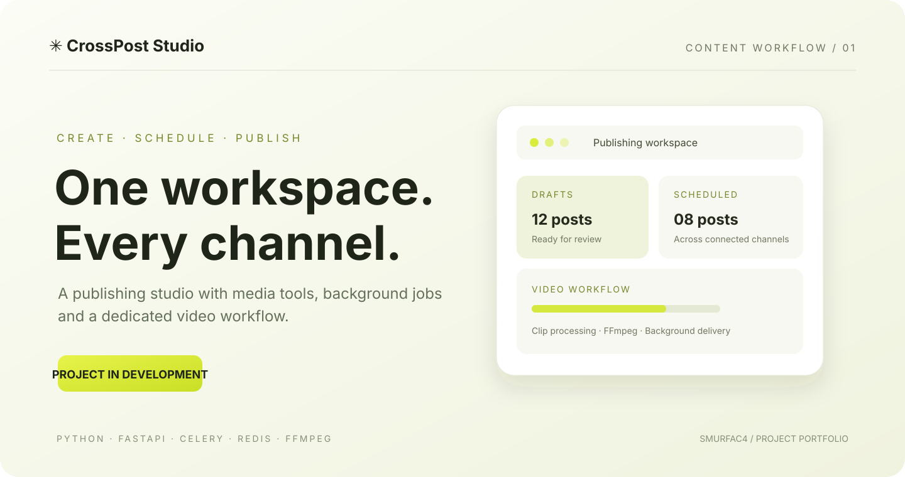

  <a href="#featured-projects">Featured projects</a> ·
  <a href="https://github.com/smurfac4?tab=repositories">All repositories</a>

## Hi, I'm Alex

I build web applications, backend services and networking tools. This profile highlights selected projects across content automation, full-stack development, programming education and VPN infrastructure.

## Featured projects

### 01 / CrossPost Studio — Content publishing & video automation

An ongoing graduation project: a publishing workspace for managing media, drafts, connected channels and scheduled delivery, with a dedicated Twitch clip workflow powered by FFmpeg.

**Python · FastAPI · SQLAlchemy · Celery · Redis · PostgreSQL · Docker · FFmpeg**

[Explore the source code](https://github.com/smurfac4/crosspost-studio) · [Workspace screenshots](https://github.com/smurfac4/crosspost-studio#workspace-and-tools) · [Verification notes](https://github.com/smurfac4/crosspost-studio/blob/main/docs/VERIFICATION.md)

*In development.* Platform publication depends on account access and provider permissions. Automated adapter tests use simulated responses; they do not guarantee live publication.

### 02 / KEYSPACE — Game-key marketplace

A full-stack storefront with catalog filters, typo-tolerant search, seller comparison, accounts and simulated checkout.

**React · TypeScript · Go · PostgreSQL**

[Explore the code](https://github.com/smurfac4/game-key-marketplace) · [Open demo](https://keyspace-smurfac4.onrender.com)

*Demo payments and non-redeemable keys only.* Free hosting may take time to wake up.

### 03 / Northline — VPN & Telegram Mini App

A Python Telegram bot and Mini App for device-wide VPN access and Telegram-only proxy connections. The backend manages profiles, server catalogs, availability checks and administration.

**Python · Telegram Mini Apps · Docker · OpenVPN · WireGuard · MTProto**

[Explore the source code](https://github.com/smurfac4/northline-vpn-bot) · [Architecture and setup](https://github.com/smurfac4/northline-vpn-bot#readme)

The illustration is a project overview, not a screenshot of a live account. Public server availability is not guaranteed.

### 04 / iRunner 2 — Programming education

A Django-based platform for programming courses, contests and automated judging. This repository extends an existing project while preserving its original authorship and history.

**Python · Django · Docker · Automated judging**

[Explore the repository](https://github.com/smurfac4/irunner2)

## Other work

- [API Dashboard](https://github.com/smurfac4/api_dashboard) — Rails API and multi-organization administration dashboard.
- [To-Do App](https://github.com/smurfac4/to_do_app) — Rails task manager with priorities, deadlines and comments.

---

Always building, learning and improving.

