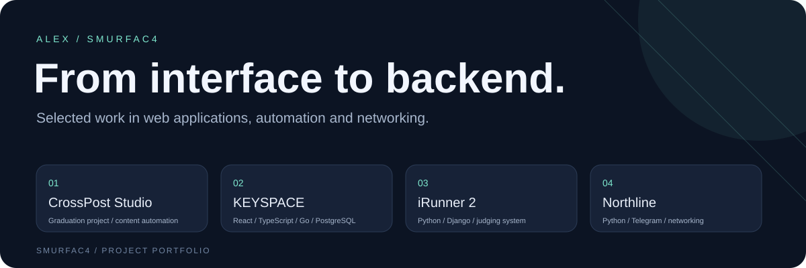

<a href="#selected-projects">Selected projects</a> · <a href="https://github.com/smurfac4?tab=repositories">All repositories</a>

## Hi, I'm Alex

This profile brings together my web application and networking work, alongside an educational platform repository. Start with the three projects below.

## Selected projects

### 01 / KEYSPACE — Game-key marketplace

A full-stack storefront with catalog filters, typo-tolerant search, seller comparison, accounts and simulated checkout.

**React · TypeScript · Go · PostgreSQL**

[Explore the code](https://github.com/smurfac4/game-key-marketplace) · [Open demo](https://keyspace-smurfac4.onrender.com)

Demo payments and non-redeemable keys. Free hosting may take time to wake up.

### 02 / iRunner 2 — Programming education

A course and contest management platform with a problem archive and automated judging of student submissions. This repository preserves an existing project's authorship and history; see its README for provenance and legacy setup notes.

**Python · Django · Judge workers**

[Explore the repository](https://github.com/smurfac4/irunner2)

### 03 / Northline — VPN & Telegram Mini App

A Telegram bot and Mini App for device VPN and Telegram proxy access, with profile management and isolated availability checks.

**Python · Telegram Mini Apps · Docker · Networking**

[Explore the source code](https://github.com/smurfac4/northline-vpn-bot)

Public source code is available. Production credentials, user data and operational history remain private.
